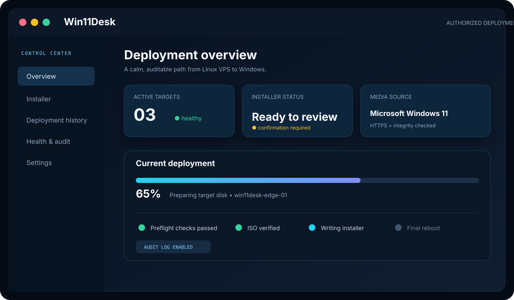

# Win11Desk

```
 __        ___       _  _ ____       _     
 \ \      / (_)_ __ | || |  _ \  ___| | __
  \ \ /\ / /| | '_ \| || | | | |/ _ \ |/ /
   \ V  V / | | | | |__   _| |_| |  __/   < 
    \_/\_/  |_|_| |_|  |_| |____/ \___|_|\_\
```

**Linux → Windows deployment, with the guardrails kept visible.**

A self-hosted Windows deployment dashboard for authorized Linux VPS targets. Win11Desk generates short-lived, integrity-checked installer commands, tracks deployment progress, and keeps sensitive credentials encrypted.

> Important: This software can replace a target server disk and reboot it. Use it only on a disposable or fully backed-up VPS that you own or are authorized to manage.

<p align="center">
  
</p>

<p align="center">
  <em>UI preview mockup — configure the dashboard with your own authorized target and Microsoft-sourced media.</em>
</p>

## Features

- Owner authentication with MFA and recovery codes
- Encrypted installer artifacts and Windows credentials
- Short-lived, capability-protected installer delivery
- Direct ISO downloads with HTTPS validation and integrity checks
- Deployment history, progress, health, audit, backup and restore tools
- Docker Compose deployment with private MySQL and Caddy HTTPS

## Windows ISO setup

This release contains no bundled ISO and no preconfigured ISO download URL.

1. Open Microsoft official Windows 11 download page: https://www.microsoft.com/software-download/windows11
2. Download or generate the Windows 11 ISO using Microsoft's instructions.
3. In Win11Desk, paste the direct HTTPS URL to the ISO into the Windows ISO URL field. A page URL is not enough; the URL must return the ISO file directly and may expire.
4. Review the selected media and target carefully before generating a command.

Win11Desk does not mirror Microsoft media, bypass Microsoft licensing, or silently switch to another source. You are responsible for using media you are licensed and authorized to use.

## Quick start

Use a separate permanent Linux VPS for the dashboard. Do not host it on the machine you intend to replace with Windows.

    python3 deploy/configure.py
    bash deploy/start.sh

Then open https://YOUR-DASHBOARD-DOMAIN/setup, create the owner account, enable MFA, configure a deployment profile, and use the Installer page.

## Development

    pnpm install
    pnpm check
    pnpm test
    pnpm build

## Security notes

Never commit .env, database backups, live credentials, private installer commands, or tokens. Read SECURITY.md before deploying. Commands are bearer secrets and must be treated like passwords.

## License and attribution

This project is MIT licensed. Microsoft, Windows, Docker, Caddy and browser names/logos are trademarks of their respective owners. Win11Desk is not affiliated with Microsoft.
